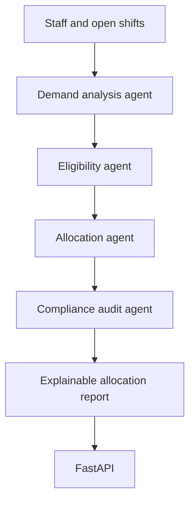

# Multi-Agent Medical Staffing & Shift Allocation

An explainable, deterministic multi-agent-style system for allocating qualified healthcare staff to open shifts. Built with Python, Pydantic, and FastAPI.

> **Demo only:** This repository uses synthetic data. It is not a clinical, employment, or regulatory decision system. A real deployment requires local labor-law, credentialing, privacy, rest-period, and human-review controls.

## Features
- Specialist agents for demand analysis, eligibility, allocation, and compliance audit
- Hard constraints for role, skills, availability, and maximum weekly hours
- Explainable assignment decisions and reasons for unfilled shifts
- REST API with interactive Swagger documentation
- Automated tests for core allocation rules
- Deterministic allocation: no LLM can override qualification or hour constraints

## Architecture



## Run locally (Python 3.10+)

```bash
python -m venv .venv
# Windows PowerShell: .venv\Scripts\Activate.ps1
# macOS/Linux: source .venv/bin/activate
pip install -r requirements.txt
uvicorn app.main:app --reload
```

Open http://127.0.0.1:8000/docs.

## API
- `GET /health` — health check
- `GET /demo-data` — synthetic staff and shift data
- `POST /allocate` — execute the allocation pipeline

## Allocation rules
1. Required role must match.
2. Staff must be available for the shift type.
3. Staff must hold every required skill.
4. The assignment must not exceed maximum weekly hours.
5. Among eligible candidates, choose the lowest current-hours / maximum-hours ratio; break ties by staff ID.
6. Process higher-priority shifts first.

This baseline does not yet model rest periods, overtime law, consecutive shifts, leave, collective agreements, location, or long-term fairness. These are explicit future improvements, not claimed capabilities.

## Roadmap
- [ ] PostgreSQL persistence and migrations
- [ ] LangChain/LangGraph conversational intake and explanation layer
- [ ] OpenAI tool calling for natural-language requests (never for hard eligibility decisions)
- [ ] Authentication and role-based access control
- [ ] Rest-period and consecutive-shift constraints
- [ ] Docker, CI, and deployment
- [ ] LangSmith tracing for optional LLM workflows

## Project structure
```text
app/
  __init__.py
  agents.py
  main.py
  models.py
tests/
  test_allocator.py
requirements.txt
```
